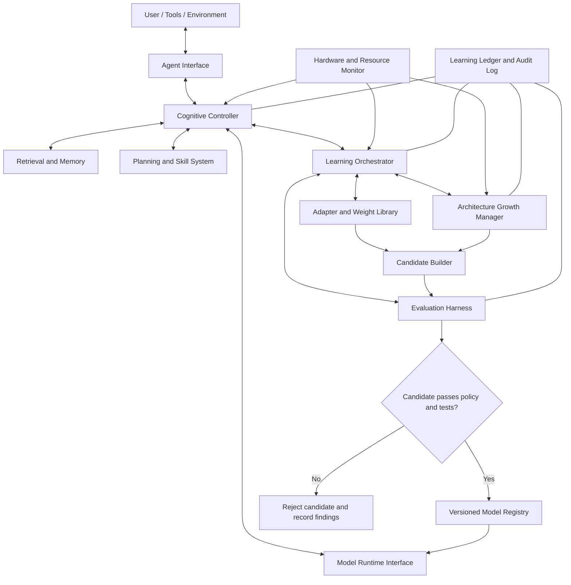
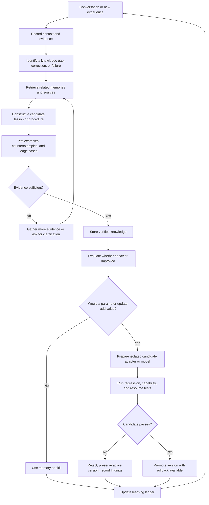

# Adaptive Cognitive Architecture (ACA)
## Design Proposal for a Hardware-Adaptive, Continuously Learning AI Agent

**Status:** Proposed architecture  
**Version:** 0.1  
**Purpose:** Define a practical architecture for an AI agent that can learn from experience, retain and consolidate knowledge, adapt to available hardware, manage learned weight updates, and eventually expand its neural architecture without losing recoverability.

---

## 1. Executive Summary

The proposed system is not just a language model with a vector database attached. It is a modular agent whose model, memory, learning mechanisms, and growth controls are separate but coordinated components.

The central principle is:

> **Build a system that knows how to improve itself, measure whether it improved, and recover when it did not.**

The agent should be able to:

- Converse and use tools through a replaceable model backend.
- Store facts, experiences, corrections, sources, and relationships.
- Retrieve relevant knowledge without requiring every fact to be baked into neural weights.
- Turn repeated experiences into tested lessons, procedures, and skills.
- Create or apply compatible learned parameter updates, such as LoRA adapters.
- Run candidate model updates in the background while the active model remains usable.
- Adapt inference and background-work settings to available CPU, RAM, GPU, VRAM, and storage.
- Eventually expand supported model dimensions or add layers through controlled architecture migrations.
- Track each change, evaluate its effects, and roll back safely.

The architecture deliberately distinguishes **knowledge accumulation**, **behavioral improvement**, **parameter learning**, and **structural growth**. These are related, but none automatically guarantees the others.

## 2. Design Principles

1. **Modularity:** Memory, model runtime, learning, adapters, and architecture management can evolve independently.
2. **Recoverability:** Never destroy the last known-good model, source code, database, or backup as part of an automated update.
3. **Evidence before promotion:** A candidate update must demonstrate improvement against repeatable tests.
4. **Portable knowledge:** Store experiences and structured knowledge in model-independent formats wherever possible.
5. **Explicit compatibility:** Every adapter or parameter patch declares which model revision and architecture it targets.
6. **Resource awareness:** Runtime and background work respect measured hardware capacity and current resource pressure.
7. **Learning at the right level:** Use memory for immediate corrections, reusable skills for repeatable procedures, and weight updates when persistent parameter changes are justified.
8. **Safe autonomy:** The agent may propose and test changes within defined limits; destructive actions and architecture migrations require policy checks and recoverable checkpoints.
9. **No growth for growth's sake:** Additional parameters are justified by measured capability bottlenecks, not by database size alone.
10. **Auditable behavior:** Claimed learning must be traceable to evidence, a change, and an evaluation result.

## 3. High-Level Architecture



### 3.1 Agent Interface

Responsible for conversation, tool invocation, user feedback, session management, and presenting results. It should not directly mutate model files.

### 3.2 Cognitive Controller

Chooses what to do next: answer from the model, retrieve knowledge, consult an external source, execute a skill, ask a clarifying question, or initiate a bounded learning task.

The controller should use explicit policies and measurable signals rather than assuming that a model's confidence statement is a calibrated probability.

### 3.3 Model Runtime Interface

Provides a stable API for interchangeable local model backends. The rest of the system should not depend directly on one inference library.

Responsibilities include:

- Loading a compatible model version.
- Generating responses.
- Reporting runtime and resource information where available.
- Loading supported adapters.
- Switching between validated model versions.
- Keeping the active model isolated from candidate builds.

### 3.4 Retrieval and Memory

Stores and retrieves model-independent knowledge. It may use relational tables, document records, full-text search, vector search, and a knowledge graph as appropriate.

### 3.5 Planning and Skill System

Stores tested procedures, reusable workflows, tool-use patterns, and task plans. A skill should include preconditions, steps, expected outputs, known failure modes, and tests when practical.

### 3.6 Learning Orchestrator

Coordinates the learning loop. It decides whether an experience should become a memory, a candidate lesson, a reusable skill, an adapter-training example, or a request for more evidence.

### 3.7 Adapter and Weight Library

Stores learned parameter artifacts separately from their metadata. It does not assume every fact or memory has a corresponding removable set of neural weights.

### 3.8 Architecture Growth Manager

Proposes and performs supported structural changes through versioned migrations. It is not allowed to resize arbitrary tensors and immediately replace the active model.

### 3.9 Evaluation Harness

Runs fixed regression tests, task-specific evaluations, retention checks, and resource tests before candidate promotion.

### 3.10 Learning Ledger

Records each claimed improvement, its evidence, the artifacts changed, evaluation outcomes, and whether the change was accepted or rejected.

## 4. Five Learning Mechanisms

### 4.1 Experience Learning

Capture useful events such as:

- User corrections and preferences relevant to the task.
- Successful and unsuccessful attempts.
- Tool results and source references.
- The context in which a conclusion was reached.
- Whether the result was independently verified.

Experience learning can update memory immediately without changing neural parameters.

### 4.2 Relationship Learning

Identify relationships between stored items, such as:

- Similarity and shared concepts.
- Causal claims, where evidence supports causation.
- Preconditions and consequences.
- Contradictions and context-dependent differences.
- Dependencies between steps in a procedure.

A relationship should carry provenance and an evidence status. Similarity alone does not establish causation or truth.

### 4.3 Behavioral Learning

Improve task performance through reusable lessons, tested procedures, prompts, policies, or skills. This may deliver substantial value without modifying the base model.

### 4.4 Parameter Learning

Create or apply neural parameter changes when evaluation suggests they are worthwhile. Options include LoRA or other adapters, gradient-based fine-tuning, and compatible parameter patches.

A tensor being correctly shaped does not establish that it is useful. Parameter changes require evaluation for both gains and regressions.

### 4.5 Architectural Learning

Identify persistent limitations that cannot reasonably be addressed through retrieval, skills, or existing model components. Propose a structural change only when evidence justifies its cost.

Potential changes, in increasing order of complexity, include:

1. Adding a new external skill or specialist module.
2. Adding or changing adapters.
3. Widening supported feed-forward sublayers.
4. Adding transformer layers.
5. Altering attention structure, embedding width, vocabulary, or the base model.

Not all architectures support every change. Each operation requires architecture-specific implementation and validation.

## 5. The Continuous Learning Loop



### Important behavior

- Corrections should influence future retrieval immediately when appropriate.
- New claims should retain their source and confidence or evidence status.
- Conflicting evidence should be preserved until resolved, rather than silently overwritten.
- Parameter updates should not be triggered for every message.
- Failed experiments are useful evidence, but must not be promoted as improvements.
- The system must be able to continue operating if background learning is disabled.

## 6. Memory and Knowledge Storage

Use storage according to the job it performs rather than forcing all information into one database.

| Store | Responsibility | Example contents |
|---|---|---|
| Experience store | What happened | Conversations, corrections, attempts, outcomes |
| Knowledge store | What is currently believed | Facts, claims, provenance, confidence, timestamps |
| Relationship index | How concepts connect | Entities, links, dependencies, contradictions |
| Vector index | Similarity-based retrieval | Embeddings with references to source records |
| Skill library | How to perform tasks | Tested procedures, workflows, preconditions |
| Learning ledger | What changed and why | Experiments, evaluations, accepted/rejected updates |
| Adapter library | Learned parameter artifacts | LoRA weights, compatible patches, manifests |
| Model registry | Which model versions exist | Base revisions, architecture specifications, checksums |

These may be implemented using fewer physical databases if the logical boundaries and ownership rules remain clear. A separate database for every logical category is not mandatory.

### Knowledge record

A proposed knowledge record should contain:

- Stable record ID.
- Content or claim.
- Source and provenance.
- Time observed and time recorded.
- Confidence or evidence status.
- Relevant context and scope.
- Links to supporting or contradicting records.
- Lifecycle state: candidate, accepted, disputed, superseded, or retired.

### Vector storage

Embeddings support retrieval. They are not automatically transformer parameter updates and cannot generally be injected into model weights just because both are arrays of numbers.

A vector record should reference the underlying knowledge or experience record so that retrieved content can be checked, updated, and traced to its source.

## 7. Adapter and Weight Management

### 7.1 Adapter manifest

Every parameter artifact should have a manifest similar to this conceptual schema:

```json
{
  "artifact_id": "adapter-example-001",
  "artifact_type": "lora_adapter",
  "base_model_id": "model-family-and-revision",
  "architecture_version": "arch-v1",
  "tensor_manifest": [
    {
      "name": "example.module.lora_A.weight",
      "shape": [8, 1024],
      "dtype": "float16"
    }
  ],
  "source_experiences": ["experience-101", "experience-102"],
  "evaluation_suite_version": "eval-v1",
  "status": "candidate"
}
```

This is an illustrative schema, not a ready-to-load adapter. Real manifests must include the actual target modules, adapter configuration, scaling parameters, format version, checksums, and all tensor metadata required by the selected library.

### 7.2 Artifact formats

- **SafeTensors:** Preferred for tensor-only artifacts that need straightforward, safe tensor loading.
- **PyTorch `.pt`:** Useful for controlled experiments and structured PyTorch serialization. Loading untrusted pickle-based files can execute unsafe deserialization behavior; do not treat arbitrary `.pt` files as safe.
- **Relational database BLOBs:** Possible for storing binary artifacts, but storage alone does not make the contents compatible or useful.
- **Object or file storage:** Often a better home for large artifacts, with database records pointing to immutable files by ID and checksum.

A practical default is to store tensor artifacts as immutable files and keep their manifests, lineage, lifecycle status, and evaluation results in a relational database.

### 7.3 Lifecycle

1. Create a candidate artifact.
2. Validate its manifest, checksum, target model, and tensor shapes.
3. Load it in an isolated evaluation process.
4. Test the artifact alone and in intended combinations.
5. Record gains, regressions, latency, and resource use.
6. Approve it for use or reject it.
7. Preserve the previous known-good version.

### 7.4 Removing learned changes

Removing an unmerged adapter can be as simple as ceasing to load it, provided no other component depends on it. Removing an update that has been merged into the base model is not generally equivalent to deleting a database row.

The reliable method is to reconstruct the candidate from a known base model plus the approved set of artifacts, then evaluate it.

Adapters may interact or interfere with one another. Compatibility checks and combination testing are necessary.

## 8. Hardware Adaptation

At startup, and periodically during operation, inspect:

- CPU architecture and available compute.
- System RAM and memory pressure.
- GPU type, supported operations, and available VRAM.
- Storage capacity and throughput.
- Model backend and quantization support.
- Current workload and resource contention.

Choose a supported operating configuration based on those measurements.

| Resource profile | Possible strategy |
|---|---|
| CPU and limited RAM | Smaller quantized model, compact indexes, limited background tasks |
| Moderate GPU and RAM | Quantized model, local retrieval, bounded parallel work |
| High-end GPU and ample RAM | Larger compatible model, faster inference, background evaluation |
| Multiple accelerators | Parallel or distributed execution only where supported and useful |

The system should not infer intelligence from hardware size. More capable hardware allows different model and workload choices, but does not automatically create learned competence.

### Resource policy

- Reserve enough resources for interactive conversation.
- Run background tasks with explicit budgets.
- Pause or throttle background work under resource pressure.
- Never start a large bake solely because the machine is idle for a moment.
- Persist task state so interrupted work can resume safely.
- Allow the user to set hard CPU, RAM, VRAM, storage, and time limits.

### Portable state

Keep knowledge, experiences, skills, and learning history as model-independent as practical. Model weights and adapters remain tied to specific architectures and revisions unless a validated conversion or migration exists.

## 9. Controlled Structural Growth

Structural growth is a separate process from learning new facts or changing existing parameter values.

### 9.1 Width expansion

A first experiment could widen a supported feed-forward sublayer:

1. Record the current architecture and parameter checksums.
2. Create a new model version.
3. Expand the relevant matrices using an architecture-specific transformation.
4. Preserve compatible existing values where mathematically appropriate.
5. Initialize new parameters using a validated strategy.
6. Run shape, numerical, behavioral, and resource tests.
7. Compare the candidate with the baseline.
8. Promote only if it passes the defined criteria.

Copying old values into a wider tensor is a starting point, not proof that the expanded model preserves behavior or benefits from its new capacity.

### 9.2 Depth expansion

Adding a transformer layer requires a defined initialization and integration strategy. The new layer must learn to contribute usefully; simply inserting random parameters into a trained network can degrade behavior.

Test the new model against the same baseline suite and additional tasks intended to benefit from the added capacity.

### 9.3 Width or depth reduction

Removing capacity can damage behavior because later computations may depend on the component being removed. Treat reductions as candidate migrations, not destructive edits to the active model.

### 9.4 Embedding and attention changes

These are higher-cost migrations because dimensions and conventions can be shared across embeddings, attention projections, residual streams, normalization, and output layers. Defer them until simpler growth operations have demonstrated value.

### 9.5 Architecture registry

Every model version should record:

- Architecture ID and schema version.
- Layer count and dimensions.
- Attention configuration.
- Vocabulary and tokenizer identity.
- Parameter names, shapes, and data types.
- Base model lineage.
- Compatible adapters.
- Evaluation results and checksums.

## 10. Evaluation and Promotion

A candidate must be compared against a fixed, versioned baseline. The tests should cover different capabilities rather than a single aggregate score.

### Core evaluation groups

1. **Language:** Grammar, coherence, instruction following.
2. **Knowledge retrieval:** Whether the correct records and sources are retrieved.
3. **Correction retention:** Whether known mistakes stop recurring.
4. **Reasoning:** Multi-step tasks and novel combinations of known concepts.
5. **Tool use:** Whether procedures execute correctly and failures are handled.
6. **Generalization:** Whether improvement transfers beyond training examples.
7. **Regression:** Whether previously working capabilities deteriorate.
8. **Resource use:** Latency, memory, throughput, and background interference.
9. **Safety and permissions:** Whether the candidate respects configured constraints.

### Promotion policy

A candidate is promoted only if it:

- Passes structural and artifact-integrity checks.
- Meets minimum task-quality thresholds.
- Does not exceed permitted regression limits.
- Fits resource constraints.
- Satisfies safety and permission requirements.
- Has a recoverable predecessor and a recorded evaluation report.

Use task-appropriate thresholds. A single score can hide important regressions, so retain per-category results.

## 11. Background Baking and Live Conversation

The active model should remain available while a candidate is built.

Suggested process:

1. Continue serving requests with the active model.
2. Gather eligible learning examples.
3. Build a candidate adapter or model in a separate workspace.
4. Evaluate the candidate.
5. Write a complete manifest and evaluation report.
6. Promote it through a controlled version switch.
7. Monitor post-promotion behavior.
8. Roll back if an unexpected regression appears.

Do not mutate model files while the active inference process is using them. Avoid partial file replacement. Use immutable versioned artifacts and an atomic update to the active-version pointer where the storage system supports it.

Keep the previous working model until the new version has passed both immediate checks and a defined observation period.

## 12. Security and Recovery

The agent should never have unrestricted authority over its own source code, backups, or active model artifacts.

Required safeguards:

- Keep source control and backups separate from automated working directories.
- Maintain at least one immutable or access-controlled known-good copy.
- Require explicit authorization for destructive file operations.
- Use least-privilege filesystem permissions.
- Verify checksums before loading or promoting artifacts.
- Treat retrieved web content and external documents as untrusted data, not executable instructions.
- Record all model promotions, migrations, retirements, and rollback events.
- Keep a recovery procedure that does not depend on the agent's current reasoning ability.
- Test restoration periodically.

A coding agent must not decide that a backup is unnecessary and delete it. Backups are governed by an explicit retention policy, not an agent's guess.

## 13. Suggested Repository Layout

```text
adaptive_agent/
├── README.md
├── pyproject.toml
├── config/
│   ├── defaults.toml
│   └── resource_policy.toml
├── agent/
│   ├── interface.py
│   ├── controller.py
│   ├── permissions.py
│   └── session.py
├── runtime/
│   ├── model_interface.py
│   ├── backend_registry.py
│   ├── hardware_probe.py
│   └── resource_monitor.py
├── memory/
│   ├── experience_store.py
│   ├── knowledge_store.py
│   ├── vector_index.py
│   ├── relationship_store.py
│   └── retrieval.py
├── skills/
│   ├── registry.py
│   ├── executor.py
│   └── validation.py
├── learning/
│   ├── orchestrator.py
│   ├── consolidation.py
│   ├── correction_handler.py
│   ├── adapter_training.py
│   └── learning_ledger.py
├── adapters/
│   ├── manifest.py
│   ├── compatibility.py
│   ├── library.py
│   └── candidate_builder.py
├── growth/
│   ├── architecture_registry.py
│   ├── width_expansion.py
│   ├── layer_migration.py
│   └── candidate_manager.py
├── evaluation/
│   ├── datasets/
│   ├── regression_suite.py
│   ├── capability_tests.py
│   └── promotion_policy.py
├── storage/
│   ├── schema.sql
│   └── migrations/
├── tests/
│   ├── test_memory.py
│   ├── test_adapter_compatibility.py
│   ├── test_learning_loop.py
│   ├── test_architecture_migrations.py
│   └── test_recovery.py
└── artifacts/
    ├── models/
    ├── adapters/
    ├── candidates/
    └── reports/
```

This is a proposed logical layout, not an instruction to create empty files immediately. Implement and test one vertical slice at a time. Do not create placeholder modules simply to make the directory tree look complete.

## 14. Implementation Roadmap

### Phase 0: Recovery and baseline

- Identify the existing working code and data.
- Create immutable backups and verify restoration.
- Record the baseline model, tokenizer, architecture, and current behavior.
- Establish a small repeatable evaluation suite.
- Confirm the existing inference and memory paths work.

**Exit condition:** The system can be restored and its current behavior can be measured.

### Phase 1: Useful agent foundation

- Implement a stable model runtime interface.
- Add hardware discovery and resource limits.
- Connect existing memory stores through a clear retrieval interface.
- Implement source provenance and correction recording.
- Add a basic skill registry.

**Exit condition:** The agent can converse, retrieve useful knowledge, retain corrections, and operate within resource limits.

### Phase 2: Verified learning

- Implement the learning ledger.
- Convert selected experiences into candidate lessons.
- Test lessons against examples and counterexamples.
- Measure correction retention and generalization.
- Separate memory updates from parameter updates.

**Exit condition:** At least one repeatable learning task demonstrates measurable behavioral improvement.

### Phase 3: Adapter library

- Define manifests and compatibility rules.
- Store adapters as immutable artifacts.
- Build isolated candidates.
- Evaluate adapter combinations.
- Implement promotion and rollback.

**Exit condition:** An adapter can be added or retired without destroying the active model or losing recoverability.

### Phase 4: Background baking

- Run candidate builds separately from inference.
- Enforce compute and memory budgets.
- Persist task state and handle interruption.
- Promote validated candidates through version switching.

**Exit condition:** Conversation remains available during a candidate build, and a failed build cannot corrupt the active model.

### Phase 5: Structural growth

- Begin with one supported width-expansion operation.
- Measure behavior and resource changes.
- Add one layer-migration strategy only after width expansion is reliable.
- Test rollback and adapter compatibility after each migration.

**Exit condition:** A structural change can be applied, evaluated, accepted or rejected, and reversed reliably.

### Phase 6: Bounded autonomous improvement

- Let the agent identify repeated failures and propose experiments.
- Prioritize changes by expected benefit, cost, and risk.
- Run only experiments within explicit limits.
- Require evaluation and policy approval before promotion.
- Keep a human-controlled escape hatch.

**Exit condition:** The agent can complete a bounded improvement cycle with an auditable record and no loss of the known-good state.

## 15. What This Architecture Does Not Promise

This design does not guarantee geometric intelligence growth, autonomous discovery of useful neural structures, or automatic conversion of arbitrary knowledge into effective weights.

It creates a framework in which these possibilities can be tested systematically.

- More data can improve coverage but also introduce noise and contradictions.
- More vectors can improve retrieval without improving the underlying language model.
- More parameters provide capacity but not necessarily competence.
- LoRA adapters can change behavior, but may interfere when combined.
- Hardware detection can select feasible workloads but cannot manufacture model capability.
- A successful test suite provides evidence, not a proof of universal competence.

The system should report what it has actually learned and measured, not equate storage growth with intelligence.

## 16. Success Criteria

The architecture is working when it can demonstrate all of the following:

- It remembers corrections and uses them in later relevant situations.
- It retrieves relevant information with traceable sources.
- It converts selected experiences into reusable, tested lessons.
- It can add and retire compatible adapters without damaging the base model.
- It can run background candidate builds without interrupting normal conversation beyond defined resource limits.
- It can detect unsupported architecture changes before loading or promoting them.
- It can expand a supported dimension and measure whether the change helped.
- It can reject a bad candidate and restore the previous working version.
- It adapts to different hardware configurations without losing portable memories and learning history.
- It maintains an auditable record of its changes and their observed effects.

## 17. Final Recommendation

Build the first version around a competent, replaceable model, portable experience memory, a tested skill system, an adapter library, and a rigorous evaluation-and-recovery loop.

Then add controlled neural growth.

The goal is not simply a brain that gets larger. It is a system that can discover where it is weak, choose an appropriate way to improve, demonstrate whether the improvement worked, and preserve everything valuable if it did not.

**Memory is what the agent retains. Learning is what changes its future behavior. Intelligence is demonstrated by what it can reliably do. Growth is the ability to improve those capabilities without losing control of the system.**
